# ultra-todo

A self-hosted, local-first task manager written in Python (Flask). It manages **any local Git repository** that contains a `.todo/tasks/` directory of plain-text JSON5 files. Hebrew and English are both supported (UI, RTL layout, and content).

> Status: v0.1 – working. Design: [PLAN.md](PLAN.md) (English) and [plan_he.html](plan_he.html) (full plan in Hebrew).

## Core ideas

- **Zero-conflict GitOps** – the managed repo holds only text (`.json5`) written by the app. No database ever touches your project.
- **Smart persistent index** – a single SQLite file in the global cache dir (`~/.cache/ultra-todo/app_global_index.sqlite3`, or the OS equivalent) serves fast lookups for all projects.
- **Git hash invalidation** – on boot the app compares `git rev-parse HEAD` (plus uncommitted changes under `.todo/`) with the cached value. Unchanged → no disk scan; changed → only the modified files are re-parsed.
- **DAG dependencies** – "blocked by" links are checked with DFS cycle detection; cycles return HTTP 400.

## Features

- Kanban board and list view
- **Priority** – high / medium / low (default medium): coloured badge on cards, priority filter, high-priority tasks listed first
- **Dependencies** – each task page shows what blocks it and what it blocks, with one-click × to remove a link and a picker to add one (cycles are rejected)
- **Tags** on tasks, with filter chips (AND / OR, shareable via URL)
- **Attachments on the ticket** – attach images and files to a ticket's description (task form: choose, paste or drop; CLI: `utd . TKT-101 attach FILE…`), stored in the ticket's own directory
- **Comments** per task: newest first, author and time stamped by the server, editable, with image/file attachments stored next to the task
- **Update** button: `git pull --ff-only`, then the index is refreshed from the diff (rebase offered if the branch diverged; aborted cleanly on conflict)
- **Save work** button: commits only `.todo/` changes (editable message) and pushes; never force-pushes, never stages files outside `.todo/`
- **Several repos** – serve many at once (free ports picked automatically); `ls` / `open` / `forget` manage the list of known repos
- **Terminal-first too** – the `utd` shortcut (with tab completion): `utd . ls`, `utd . board`, `utd . TKT-101 done`, `utd . new "…"`, `utd . save`: browse and change tickets, comment, set dependencies and sync without opening the browser
- Hebrew + English: translated UI, RTL layout, `dir="auto"` for mixed-language content; language set with `--lang` and/or the in-app toggle

## Screenshots

**Kanban board** – tasks by status, with priority, assignee, tags and dependency badges; search and filter on top.

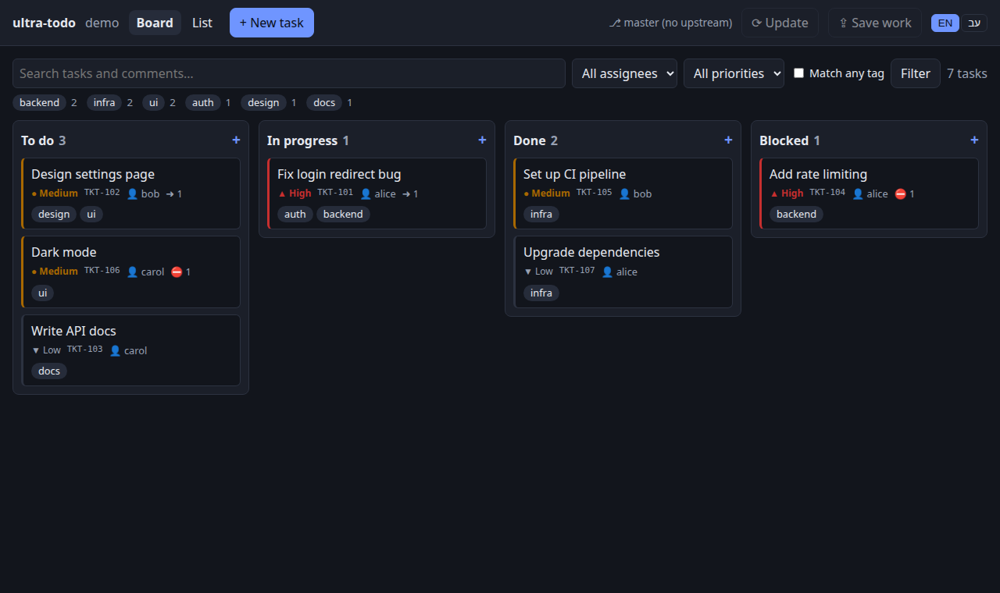

**List view**

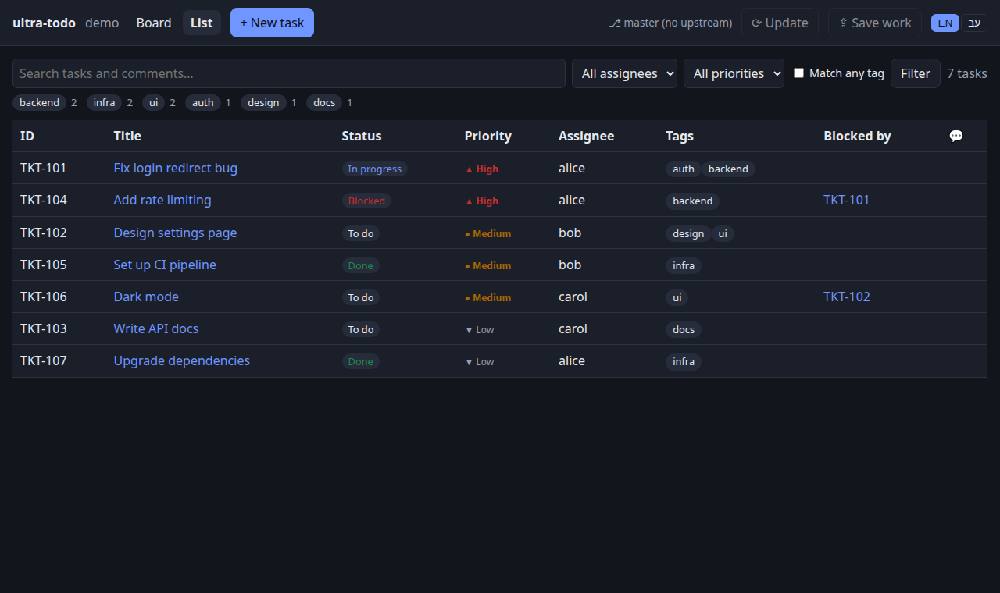

**Adding a task**

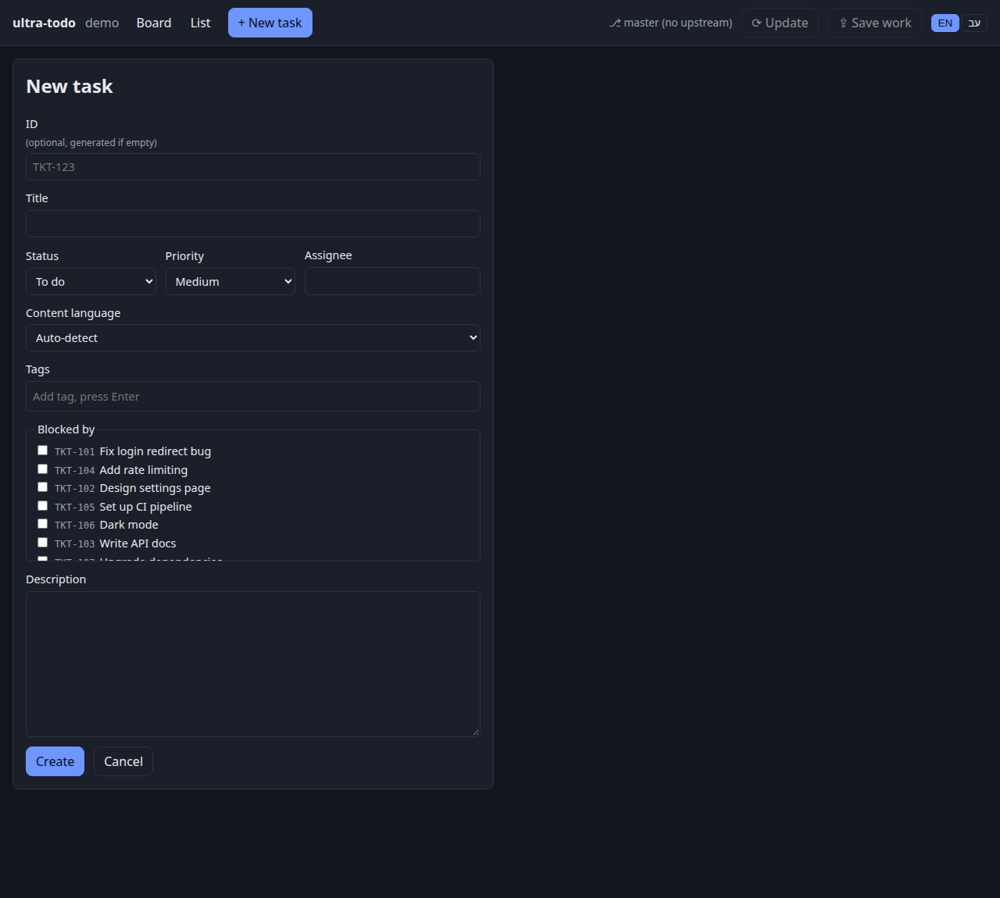

**Command line** – the same tickets in the terminal ([details below](#terminal-tickets-from-the-command-line)).

**Board** (`utd . board`)

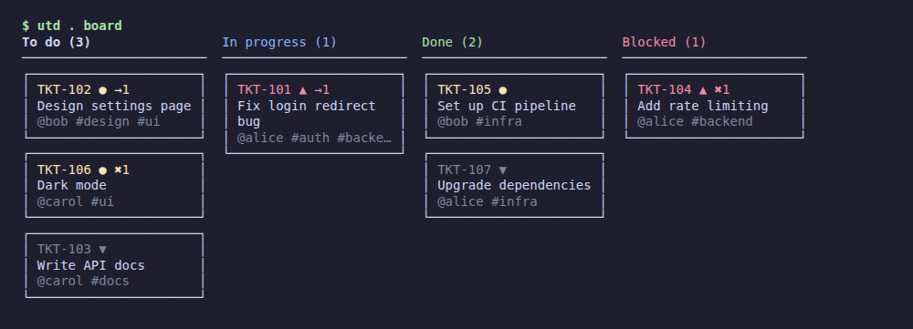

**List** (`utd . ls`, plus the project info)

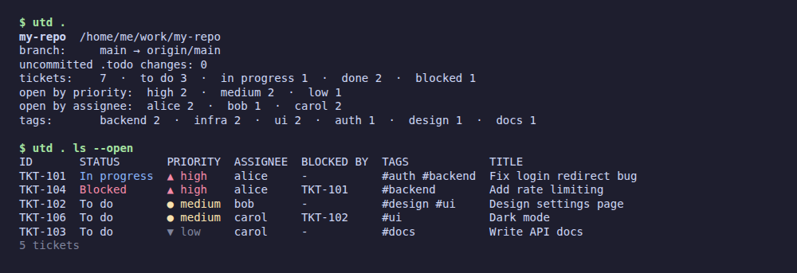

**Ticket** (`utd . TKT-101`)

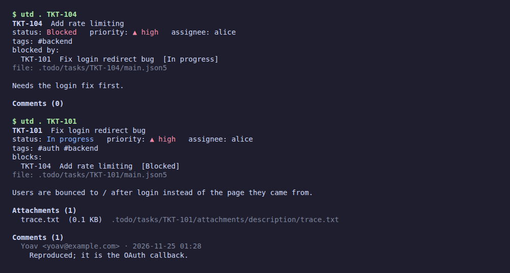

**Commands**

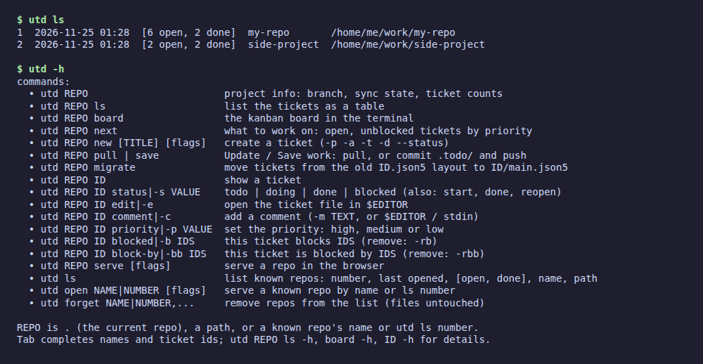

## Install and run (uv)

```bash
uv sync
uv run ultra-todo --target /path/to/your/repo            # http://127.0.0.1:8080
uv run ultra-todo --target /path/to/repo --lang he --port 9000 --auto-commit
```

Global install: `uv tool install .` then `ultra-todo --target ...`.
Without uv: `pip install -r requirements.txt && python src/app.py --target ...`.

Several repos can be served at once: without `--port`, each instance takes the first free port
from 8080 up (8080, 8081, …) and logs which repo it serves where; the browser tab shows the repo name.

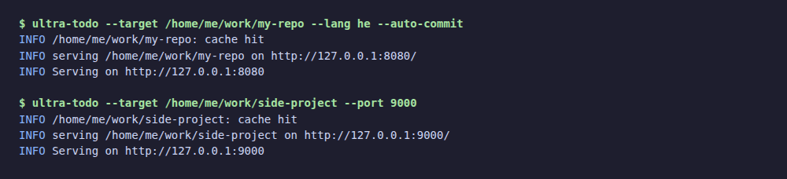

## Known repos: `ls`, `open`, `forget`

Every repo you serve is remembered, so you can list it and open it again by name or number.
Each command has its own help: `ultra-todo ls -h`, `ultra-todo open -h`, `ultra-todo forget -h`.

```bash
ultra-todo ls                       # numbered list, most recently opened first
ultra-todo open my-repo             # serve a known repo by name (case-insensitive)
ultra-todo open 1 --lang he         # ...or by its ls number; serve flags still work
ultra-todo forget 3,5               # remove repos from the list (or: forget old-repo 4)
```

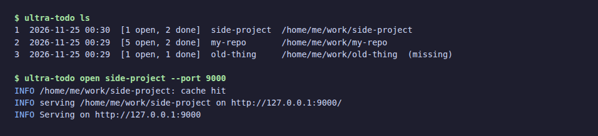

- **number** – use it with `open` / `forget`. Numbers follow the `ls` order, so they shift when you open another repo (`open 1` = the last one you used).
- **last opened** – local time; `-` for repos imported from the cache that haven't been opened since.
- **[x open, y done]** – open = todo, in progress and blocked. Each repo's index is refreshed first, so counts include `git pull`s and uncommitted edits made outside ultra-todo.
- **(missing)** – the directory is gone; it can't be opened but can be forgotten.

Details:
- The list lives in `repos.json` in the user data dir (`~/.local/share/ultra-todo/` on Linux), not in the cache, so clearing the cache doesn't lose it. Repos already in the cache index are imported.
- If two repos share a name, `open` lists both paths; use the number or the path.
- `forget` resolves all names/numbers against one listing first (so `3,5` means what `ls` showed), removes nothing if any is unknown, and also drops the repo's cached index. The repo's files are never touched; serving it again adds it back.

## Terminal: tickets from the command line

Everything below works as `utd …` (the shell shortcut, next section) or `ultra-todo …`.
`REPO` is `.` (the repo you are in), a path, or the name or `ls` number of a known repo.

```bash
utd .                         # project info: branch, sync state, ticket counts
utd . ls                      # tickets as a table; filters: --status --priority --assignee -t TAG --any -q TEXT --open --mine
utd . board                   # the kanban board (columns stack on a narrow terminal)
utd . next                    # what to work on: open, unblocked, highest priority first
utd . TKT-101                 # show a ticket (case-insensitive; a bare 101 works too)
utd my-repo ls --status todo  # by known repo name (or number)
utd . serve --port 9000       # serve the web UI (what `utd` alone used to do)
```

(What the board, list and ticket views look like: see [Screenshots](#screenshots).)

Change tickets (every change is a file edit under `.todo/`, nothing is committed until `save`):

```bash
utd . new "Fix login" -p high -a alice -t backend -t auth -d "details"   # prints the new id; no title opens $EDITOR
utd . TKT-101 start | done | reopen      # or: status doing|done|todo|blocked, or -s doing
utd . TKT-101 priority high              # or -p high (h, m, l work too)
utd . TKT-101 edit                       # or -e: open the ticket file in $VISUAL / $EDITOR; validated on exit
utd . TKT-101 comment -m "text"          # or -c; without -m: $EDITOR, or stdin (echo hi | utd . TKT-101 -c)
utd . TKT-101 attach shot.png log.txt    # or -a: attach files to the description; detach NAME (-d) removes one
utd . new "Crash" --attach trace.txt     # a new ticket with files attached
utd . TKT-101 blocked 104 105            # or -b: TKT-101 blocks 104 and 105
utd . TKT-104 block-by 101               # or -bb: TKT-104 is blocked by 101 (the same link, seen from the other side)
utd . TKT-101 remove blocked 104         # or -rb;  remove block-by 101 / -rbb
```

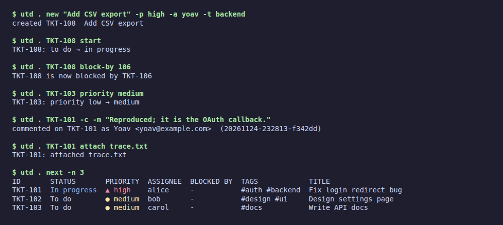

Sync, the same as the app's buttons:

```bash
utd . pull [--rebase]                    # Update: git pull --ff-only, then refresh the index
utd . save [-m "message"] [--set-upstream]   # Save work: commit only .todo/, then push; never force-pushes
```

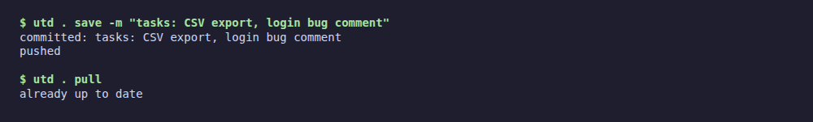

Details:
- `ls`, `board`, `next` and the ticket view take `--json` (the info command too) for scripts; `ls --ids` prints just the ids.
- `--mine` matches the assignee against `git config user.name` (or the part of `user.email` before the `@`).
- Dependency changes refuse cycles and self-links (exit code 1, nothing written). A `remove block-by` also works on ids that no longer exist.
- `save` commits whatever changed under `.todo/` and then pushes; if the branch has no upstream it has already committed and tells you to rerun with `--set-upstream`. `pull` stops cleanly on conflicts, like the app.
- Colours follow the terminal: off when piped, off with `NO_COLOR`, forced with `CLICOLOR_FORCE=1`.
- `utd . migrate` moves tickets from the old flat `ID.json5` layout to `ID/main.json5` (see [File formats](#file-formats)); nothing is committed until `save`.
- Per-command help: `utd . ls -h`, `board -h`, `new -h`, `next -h`, `pull -h`, `save -h`, `utd . TKT-1 -h`.
- Breaking change: `utd` alone and `utd PATH` used to serve a repo; that is now `utd . serve` / `utd PATH serve` (`utd open NAME` and `ultra-todo --target PATH` are unchanged).

## Shell shortcut: `utd`

`shell/utd.bash` defines `utd` (runs ultra-todo from any directory) and its tab completion. Add one line
to `~/.bashrc` and `source ~/.bashrc`:

```bash
source /path/to/ultra-todo/shell/utd.bash
```

(If you pasted the old `utd` function there, replace it with this line.) It needs `uv` on the `PATH`.

`utd -h` lists every command with its flags.

Tab completion covers the commands, repo names and directories, then per repo: the actions, ticket ids
(`utd . TK<Tab>`), values after `status` / `priority` / `-p` / `-s`, ids after `blocked` / `block-by` /
`remove`, and the flags of each command. `ls`, `open`, `forget` are commands, so to use a repo or
directory with one of those names write `utd ./ls`.

### CLI flags

| Flag | Meaning |
|---|---|
| `--target PATH` | Git repo to manage (must contain or get `.todo/tasks/`); `utd REPO serve` sets it for you |
| `--lang he\|en` | Default UI language (users can override in the UI) |
| `--host ADDR` | Address to bind (default `127.0.0.1`, local only) |
| `--port N` | Port (default: first free port from 8080 up); a busy explicit port is an error |
| `--auto-commit` | Commit each change as `task: update <ID>` |
| `--author NAME` | Override the comment author (default: `git config user.name`) |
| `--max-attachment-mb N` | Attachment size limit (default 10) |
| `--db PATH` | Use another SQLite index file (repos served this way are not added to the known list) |
| `--threads N` | Server threads (default 8) |
| `--debug` | Flask dev server with auto-reload and debug logging |

## File formats

```
<repo>/.todo/tasks/
└── TKT-101/                                  # one directory per ticket
    ├── main.json5                            # the ticket itself
    ├── comments/20261018-100000-ab12cd.json5 # one file per comment: UTC date-time + random id
    └── attachments/
        ├── description/error.png             # attached to the ticket's description
        └── 20261018-100000-ab12cd/screenshot.png   # attached to that comment
```

Task:

```json5
{
  id: "TKT-101",
  title: "תיקון באג בהתחברות",
  status: "in_progress",        // todo | in_progress | done | blocked
  priority: "high",             // high | medium | low (optional, default medium)
  assignee: "yoav",
  description: "…",
  tags: ["backend", "דחוף"],
  blocked_by: ["TKT-099"],
  attachments: [{ name: "error.png", file: "attachments/description/error.png", mime: "image/png", size: 4821 }],  // optional
}
```

Comment (one file per comment, so concurrent comments never conflict):

```json5
{
  id: "20261018-100000-ab12cd",       // = file name: UTC YYYYMMDD-HHMMSS + random hex
  author: "Yoav <yoav@example.com>",     // from git config, set by the server
  created_at: "2026-10-18T10:00:00.123Z",
  edited_at: null,
  body: "…",
  attachments: [{ name: "screenshot.png", file: "attachments/20261018-100000-ab12cd/screenshot.png", mime: "image/png", size: 48213 }],
}
```

Notes:
- Hand-written JSON5 (comments, unquoted keys, trailing commas) is read fine, but when the app saves a task it rewrites the file as deterministic JSON (valid JSON5), so `//` comments in that file are lost. Extra fields you add are kept.
- Attachments are user files committed to the repo; consider Git LFS for large ones. PNG/JPEG/GIF/WebP show inline; everything else (including SVG) is served as a download.
- Only the comment's author (by git identity) can edit or delete it.
- **Older layout**: tickets used to be a flat `.todo/tasks/TKT-101.json5` and comment ids looked like `20261018T100000123Z-ab12cd`. Both are still read (and flat tickets are edited in place), so nothing breaks; `utd REPO migrate` moves the flat files into `TKT-101/main.json5` with `git mv`. The app and `utd REPO` warn while flat files remain. If both a flat and a nested file exist for one ticket the nested one wins.
- Uncommitted edits under `.todo/` are picked up too (the cache key is `HEAD` + the dirty-file list).

## Translations

```bash
uv run pybabel extract -F babel.cfg -k _ -k gettext -k ngettext:1,2 --no-location -o src/translations/messages.pot src
uv run pybabel update -i src/translations/messages.pot -d src/translations
uv run pybabel compile -d src/translations
```

## Development

```bash
uv run pytest                      # engine, sync (temp bare remote + 2 clones), routes, i18n, repos list, terminal commands (incl. save/pull against a temp remote)
uv run ultra-todo --target . --debug   # Flask dev server with reload
```

Layout: `src/engine.py` (files, git, SQLite index, sync), `src/graph.py` (DAG), `src/repos.py` (known-repos list), `src/i18n.py`, `src/cli.py` (the `REPO ls|board|next|new|pull|save|ID …` terminal commands), `src/app.py` (routes, serve, `ls`/`open`/`forget`), `shell/utd.bash` (the `utd` shortcut + completion), `docs/screenshots/` (README images), `src/templates/`, `src/static/`, `src/translations/`.
