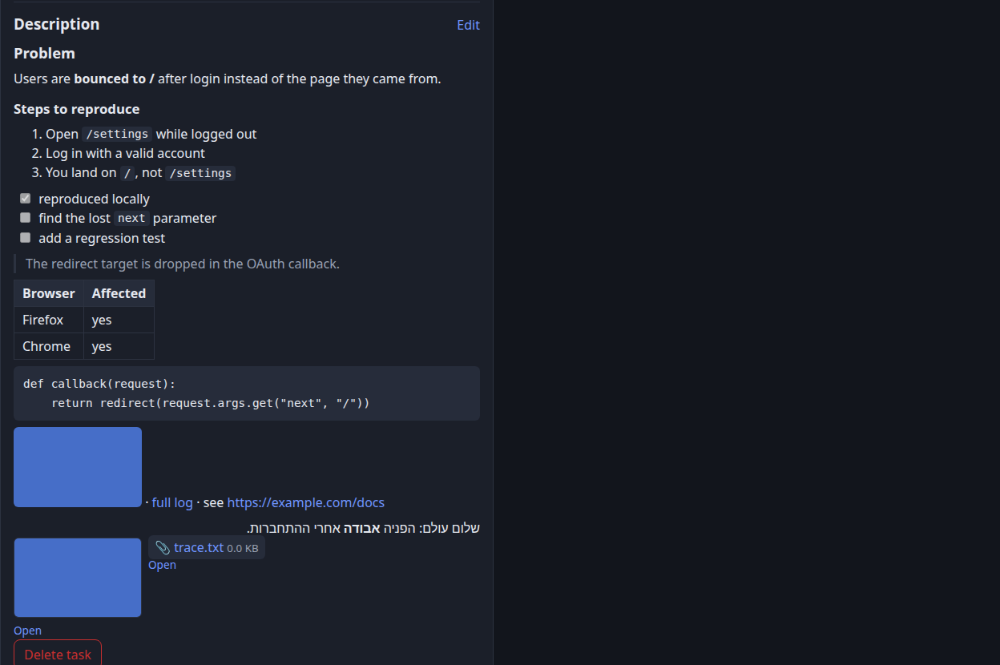

# ultra-todo

A self-hosted, local-first task manager for **any Git repository**. Tickets are plain-text files in `.todo/tasks/`,
so your tasks live, branch and merge with your code. Use it from the browser, from the terminal, or both.
Hebrew and English are fully supported (right-to-left layout, mixed-language text).


## Highlights

- **Zero-conflict GitOps** – the repo holds only text files written by the app; no database ever touches your project.
  Comments, attachments and tickets each get their own file, so teammates rarely conflict.
- **Board, list and ticket pages** – priorities, tags with AND/OR filters, comments, file attachments, and
  dependencies (cycles are refused) with a one-click blocker tree.
- **Markdown everywhere** – descriptions and comments render headings, tables, task lists, code and links, with
  **Mermaid diagrams** (drawn offline), live Preview and a built-in Cheatsheet. Edit the description in place.
- **A full terminal client** – `utd . ls`, `utd . board`, `utd . next`, `utd . TKT-101 done`, `utd . new "…"`:
  filter, sort, export to CSV/Markdown, comment, attach files and change dependencies without a browser.
- **Interactive REPL with Tab completion** – `utd` inside a repo, then `cd TKT-101` and just type `done`, `tag +ui`,
  `comment -m …`.
- **Git built in** – *Update* (`pull --ff-only`) and *Save work* (commits only `.todo/`, never force-pushes), in the
  web UI and as `utd . pull` / `utd . save`.
- **Many repos at once** – each gets its own port; `utd open my-repo` serves it and opens your browser.
- **Fast and forgiving** – a SQLite index that git keeps honest; files that cannot be read are skipped with a warning
  and retried; hand-edited JSON5 is welcome.
- **Local and offline** – no accounts, no cloud, nothing downloaded at run time (even the diagram library ships with it).

<table>
<tr>
<td width="50%"></td>
<td width="50%"></td>
</tr>
<tr>
<td align="center"><sub>Markdown description, with an Edit button</sub></td>
<td align="center"><sub>The same board in the terminal</sub></td>
</tr>
</table>

## Quick start

```bash
uv sync
uv run ultra-todo --target /path/to/your/repo        # then open http://127.0.0.1:8080
```

For everyday use, add the `utd` shortcut (with tab completion) to `~/.bashrc`:

```bash
source /path/to/ultra-todo/shell/utd.bash
```

```bash
utd open                      # serve the repo you are in and open the web UI
utd                           # ...or open the interactive prompt
utd . ls --open               # the open tickets, as a table
utd . TKT-101                 # one ticket (a bare 101 works too)
utd . new "Fix the login redirect" -p high -a alice -t backend
utd . TKT-101 done            # d is short for done; every command has a short form
utd . save                    # commit .todo/ and push
```

Without `uv`: `pip install -r requirements.txt && python src/app.py --target …`.

## Documentation

- **[User guide](docs/GUIDE.md)** – everything in detail:
  [Markdown syntax](docs/GUIDE.md#markdown) ·
  [terminal commands](docs/GUIDE.md#terminal-tickets-from-the-command-line) ·
  [short forms](docs/GUIDE.md#short-forms) ·
  [the REPL](docs/GUIDE.md#interactive-mode-repl) ·
  [several repos](docs/GUIDE.md#known-repos-ls-open-forget) ·
  [the `utd` shortcut](docs/GUIDE.md#shell-shortcut-utd) ·
  [command-line flags](docs/GUIDE.md#cli-flags) ·
  [file formats](docs/GUIDE.md#file-formats) ·
  [translations and development](docs/GUIDE.md#translations)
- **[PLAN.md](PLAN.md)** – design and decisions (English); **[plan_he.html](plan_he.html)** – the full plan in Hebrew.

## Development

```bash
uv run pytest                          # ~155 tests: engine, index, sync, routes, CLI, REPL, Markdown
uv run ultra-todo --target . --debug   # dev server with reload
```
